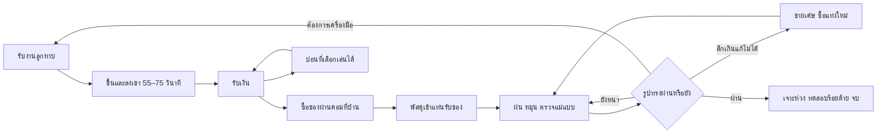

# NEEDLIT — ฝนทั่งให้เป็นเข็ม

เอกสารออกแบบเกม v1.0 — 14 ตุลาคม 2026

สถานะ: แบบสำหรับเริ่มพัฒนา ยังไม่ใช่เกมที่สร้างหรือทดสอบแล้ว ตัวเลขราคา เวลา และความยากทั้งหมดเป็นค่าเริ่มต้นสำหรับ playtest

อ่านคู่กับ [แผนพัฒนาและขั้นตอนทำงานของ agent](DEVELOPMENT_PLAN.md) และ [checklist ตรวจรับ](CHECKLIST.md)

## 1. เกมที่เราจะทำ

เกมจำลองชีวิตมุมมองบุคคลที่หนึ่งแบบเล่นคนเดียว บรรยากาศชุมชนเชิงเขาไทยกึ่งสมจริงกึ่งตลก ผู้เล่นเป็นลูกหาบที่มีเป้าหมายเหลือเชื่อ: ฝนเหล็กทรงเสาขนาดเส้นผ่านศูนย์กลาง 30 เซนติเมตร ยาว 1 เมตร ให้กลายเป็นเข็มเย็บผ้ายาว 5 เซนติเมตรตามแม่แบบ

ขึ้นเขาหาเงินรอบละประมาณหนึ่งนาที กลับบ้านฝนเหล็ก สั่งเครื่องมือจากคอมพิวเตอร์ รอพัสดุ และแวะบ่อนในซอยหลังบ้านเมื่ออยากเสี่ยง เครื่องมือค่อย ๆ เปลี่ยนจากหินราคาถูกเป็นเครื่องจักรบ้าพลัง แต่ช่วงสุดท้ายยังต้องอาศัยมือผู้เล่น เพราะเนื้อเหล็กที่หายไปเอาคืนไม่ได้

**คำโปรยต้นแบบ:** “หาบของขึ้นเขา เพื่อหาเงินมาฝนเสาเหล็กให้เป็นเข็ม ซื้อเครื่องเจียรให้แรงได้ แต่อย่าฝนเลยเส้น”

ชื่อ NEEDLIT เป็นชื่อทำงาน ต้องตรวจชื่อซ้ำและสิทธิ์ก่อนใช้ขายจริง

### เสาหลักการออกแบบ

1. **ทุกการลากเปลี่ยนวัตถุจริง:** ฝนซ้ายสึกซ้าย ต้องหมุนตรวจอีกด้าน ไม่มีหลอด progress แทนรูปร่าง
2. **งานมหึมา แต่ผลตอบรับเร็ว:** เห็นผิวเปลี่ยนตั้งแต่ไม่กี่วินาทีแรก และมีการซื้อที่เปลี่ยนวิธีเล่นในสิบนาทีแรก
3. **แรงขึ้นต้องรับผิดชอบมากขึ้น:** เครื่องมือแรงลดเวลาทำงาน แต่ทิ้งรอยลึกและควบคุมยากใกล้แม่แบบ
4. **ชีวิตข้างโต๊ะฝนมีสีสัน:** งานลูกหาบ บ่อน แพ็กเกจสินค้า และเพื่อนบ้านช่วยเปลี่ยนจังหวะ ไม่แย่งบทจากเข็ม
5. **แพ้ได้ แต่กลับมาได้:** ฝนพลาดต้องซื้อเหล็กใหม่จริง แต่เก็บบ้าน เครื่องมือ ความคืบหน้าเนื้อเรื่อง และรายได้พื้นฐานไว้

### ขอบเขตฉบับขาย 1.0

| หัวข้อ | ขอบเขต |
|---|---|
| แพลตฟอร์ม | Windows 64-bit, Steam, เล่น offline ได้ |
| ผู้เล่น | Single-player; ไม่มี multiplayer ใน 1.0 |
| การควบคุม | เมาส์และคีย์บอร์ด ปรับปุ่ม ความไว และรูปแบบกดค้างได้ |
| ภาษา | ไทยและอังกฤษสำหรับ UI บทพูด กติกา และ tutorial |
| ระยะเล่นเป้าหมาย | จบครั้งแรก 4–6 ชั่วโมง; ผู้เล่นชำนาญอาจสั้นกว่า; ไม่ยืดเกมเพื่อกัน refund |
| โลก | บ้าน+หลังบ้าน+ซอยบ่อนหนึ่งพื้นที่ และเส้นทางภูเขาหนึ่งเส้นที่มีชุดอุปสรรค 3 แบบ |
| เป้าหมายหลัก | เข็มมาตรฐานหนึ่งแบบ พร้อมห่วงเข็มและฉากจบ |
| หลังจบ | แม่แบบเพิ่ม 2 แบบ ใช้ระบบเดิม; ทดลองอุปกรณ์และกลับไปเล่นมินิเกม |
| เนื้อหาอุปกรณ์ | 16 รายการรวมของเริ่มต้น แบ่งเครื่องฝน เครื่องวัด ระบบช่วย และลูกหาบ |
| บ่อน | Poker, Blackjack, High-Low, Slot และเพิ่มทอยเต๋า เหรียญหัวก้อย เป่ายิ้งฉุบ รวม 7 เกม |
| รูปแบบขาย | ซื้อเกมครั้งเดียว ไม่มีเงินจริงในบ่อน ไม่มีเติมเงิน/ถอนเงิน/ตลาดขายไอเทม |

ไม่รวม open world ขนาดใหญ่ ระบบหิว/กระหาย ค่าเช่ารายวัน การต่อสู้ ตำรวจไล่จับ พนักงานอัตโนมัติ หรือการสร้างโรงงานอิสระ สิ่งเหล่านี้ไม่ได้จำเป็นต่อประสบการณ์ที่ขอ

## 2. เกมอ้างอิงและสิ่งที่นำมาใช้

ผู้ใช้ยืนยันว่า **Needle In A Haystack ของ NoGlyph** เป็นเกมอ้างอิง ไม่ใช่เกมชื่อใกล้กันของ Studio Bitdot

| แหล่งอ้างอิง | ข้อมูลที่หน้าเกมระบุ | แนวทางนำมาใช้ใน NEEDLIT |
|---|---|---|
| [Internet Cafe Simulator 2 — Cheesecake Dev](https://store.steampowered.com/app/1563180/Internet_Cafe_Simulator_2/) | การหาเงิน พัฒนากิจการ/อุปกรณ์ และชีวิตในย่านที่มีเรื่องวุ่นวาย | บ้านที่เริ่มโทรมแล้วค่อยมีเครื่องมือดีขึ้น การใช้คอมในโลกเกม และ NPC ใกล้บ้านที่มีบุคลิก |
| [Needle In A Haystack — NoGlyph](https://store.steampowered.com/app/5085740/Needle_In_A_Haystack/) | งานค้นหาเข็มในกองฟางขนาดใหญ่ หาเงินซื้อเครื่องมือ ทดลองวิธีจัดการ และมีกิจกรรมให้เสียสมาธิ; รองรับ co-op | งานเล็กที่ซ่อนในงานมหึมา เครื่องมือที่เปลี่ยนสเกลงาน อารมณ์ขัน และสิ่งล่อใจระหว่างทาง |

ตารางด้านขวาเป็นการออกแบบของเรา ไม่ใช่การอ้างว่าเกมต้นแบบมีระบบเดียวกันทั้งหมด การค้นคว้ารอบนี้อ่านหน้า Steam และเนื้อหาที่เผยแพร่ ไม่ได้ทดลองเล่นเกมทั้งสองโดยตรง ไม่คัดลอกฉาก ตัวละคร UI เสียง หรือ asset และไม่ถือว่า co-op เป็นข้อกำหนดของเกมเรา

## 3. โลก ตัวละคร และลำดับประสบการณ์

### เรื่องย่อ

ผู้เล่นกลับมาอยู่บ้านเก่าเชิงเขา พบแท่งเหล็กที่ญาติทิ้งไว้กับกล่องแม่แบบเข็ม และข้อความว่า “ทำให้ได้สักเล่ม แล้วค่อยบอกว่าทำไม่ได้” ไม่มีหนี้นับถอยหลัง ไม่มีเส้นตาย สิ่งที่ขับเคลื่อนคือความอยากเอาชนะงานที่ดูไม่มีเหตุผลและความภูมิใจที่ได้เห็นมันเล็กลงจริง

ตัวละครใช้ silhouette ชัด แอนิเมชันน้อย และบทพูดสั้น:

| ตัวละคร | รูปร่าง/เอกลักษณ์ | หน้าที่ |
|---|---|---|
| ผู้เล่น | เห็นแขน ถุงมือ และคานหาบ ไม่ต้องสร้างตัวเต็มในช่วงแรก | เชื่อมทุกกิจกรรม |
| ป้าสาย | หมวกปีกกว้าง สมุดบัญชี กระเป๋าคาดเอว | รับงานที่ตีนเขา อธิบายค่าจ้าง |
| ลุงยอด | เสื้อกั๊กสีส้มกับแก้วชาใบใหญ่ | รับของบนเขาและให้คำพูดกวนสั้น ๆ |
| เจ๊แต้ม | แว่นเหลี่ยม พัดลายไพ่ | เจ้าบ่อนและผู้สอนกติกา |
| เปี๊ยก | เสื้อใหญ่กว่าตัว สายวัดคล้องคอ | เพื่อนบ้านที่ให้คำแนะนำเมื่อถึง milestone |
| นักพนัน 2 คน | คนหนึ่งหมวกเล็ก อีกคนไหล่กว้าง | คู่แข่ง poker และเสียงบรรยากาศ |

ไม่มี NPC เดินทั่วเมืองหรือจำลองชีวิตเต็มรูปแบบ ใช้จุดประจำตัวและแอนิเมชันเฉพาะที่จำเป็น

### แผนผังพื้นที่

```text
             [เส้นทางภูเขา → จุดส่งของ]
                         |
                    [ป้าสาย/รับงาน]
                         |
 [บ้าน: คอม + ที่รับพัสดุ] — [ลานหน้า/ทางเข้า]
             |
 [หลังบ้าน: โต๊ะฝน + ชั้นวางผลงาน]
             |
          [ซอยสั้น]
             |
      [บ่อน: ไพ่ + เครื่องสล็อต]
```

บ้านถึงจุดรับงานหรือบ่อนใช้เวลาเดินประมาณ 10–15 วินาที ต้องไม่เสียเวลาเดินไกลทุกครั้งที่อยากเปลี่ยนกิจกรรม ภูเขาเป็นฉากแยกเมื่อรับงาน; ไม่ต้องเดินขึ้นภูเขาโลกเปิดก่อนเริ่มมินิเกม

### สิบนาทีแรก

| เวลาเป้าหมาย | ประสบการณ์ |
|---|---|
| 0:00–1:00 | เห็นเหล็กยักษ์เทียบเข็มจริงบนแท่น ทดลองลากฝนแล้วเห็นร่องทันที |
| 1:00–2:00 | หมุนเหล็ก พบว่าอีกด้านยังหนา เปิดภาพซ้อนแม่แบบ |
| 2:00–3:15 | รับงานและหาบหนึ่งรอบ เรียนรู้การทรงตัว |
| 3:15–5:00 | เปิดคอม ซื้อหินหยาบ พัสดุมาถึงระหว่างฝนต่อ |
| 5:00–8:00 | ทดลองเครื่องมือใหม่ เห็นความเร็วต่างกัน และคำเตือนพื้นที่บาง |
| 8:00–10:00 | รู้จักบ่อนแบบเลือกไปเอง เห็นเป้าหมายอัปเกรดถัดไปและบันทึกเกม |

Tutorial สอนในกิจกรรมจริง กดข้าม/เปิดดูใหม่ได้ ไม่บังคับเดิมพัน และไม่มีของแจกที่ต้องเล่นบ่อนเพื่อรับ

### โครงสร้างแคมเปญ

1. **เสายักษ์:** เรียนรู้ฝน หมุน หาบ และสั่งของ; เห็นการเปลี่ยนรูปแบบใหญ่
2. **แท่งพอจับ:** ลดส่วนเกินตามยาวและรอบวง ซื้อเครื่องมือมอเตอร์; งานค่าจ้างระดับสองเปิด
3. **แท่งขนาดดินสอ:** เริ่มให้ความสำคัญกับศูนย์กลาง ความตรง และการหยุดเครื่องมือแรง
4. **เข็มเกือบเสร็จ:** มุมมองขยาย เครื่องมือเล็ก หัวเข็ม และห่วงเข็ม; งานค่าจ้างสูงเปิด
5. **หนึ่งเล่มที่ทำได้:** ตรวจรูปทรง เจาะห่วง แล้วทดลองร้อยด้าย รับฉากจบและเก็บชิ้นงานบนชั้น

Milestone ใช้สัดส่วนเนื้อส่วนเกินที่เหลือเทียบพื้นที่เป้าหมายและขนาด bounding box ร่วมกัน ไม่ใช้เปอร์เซ็นต์ปริมาตรอย่างเดียวซึ่งจะค้างที่ 99.99% เกือบทั้งช่วงท้าย ป้าย milestone ที่ปลดแล้วไม่ย้อนกลับเมื่อซื้อเหล็กใหม่

## 4. วงจรเกมและความสำเร็จ



ชัยชนะไม่ได้เกิดจากมีเงินครบหรือเก็บเลเวลครบ ต้องมีชิ้นงานที่ผ่านการตรวจจริง เครื่องมือทุกชิ้นเป็นวิธีช่วยทำงาน ไม่สามารถซื้อ “เข็มสำเร็จรูป” เพื่อจบเกม

## 5. ระบบฝนเหล็ก: หัวใจของเกม

### 5.1 รูปร่างและสเกล

- เหล็กเริ่มต้นทรงกระบอกแบบมีเหลี่ยมเล็กน้อย ยาว 1,000 มม. เส้นผ่านศูนย์กลาง 300 มม. (ปรับตามผู้ใช้: 30 ซม.)
- แม่แบบหลักยาว 50 มม. ลำตัวกว้างประมาณ 1.5 มม. หัวกว้าง 2.2 มม. ปลายเรียว; ห่วงเข็มเป็นขั้นตอนจบต่างหาก
- แสดงแม่แบบเข็มจริงข้างแท่น และ ghost ที่ตำแหน่งภายในเหล็ก เปิด/ปิดได้ตลอด
- ตำแหน่งแกนแม่แบบยึดกับปากกาจับงาน ไม่ย้ายแม่แบบเพื่อให้งานเสียกลับมาผ่านเอง
- ผู้เล่นต้องฝนทั้งเส้นรอบวงและหน้าปลายเพื่อให้ความยาวลดลง การฝนด้านข้างอย่างเดียวไม่ทำให้เหล็กสั้นลง
- กล้องโต๊ะฝนมีระยะเต็มชิ้น ใกล้ และขยาย พร้อมตัวเลขมิลลิเมตร ไม่เปลี่ยนขนาดจริงของวัตถุเมื่อซูม
- การจำลองเป็นงานช่างแบบ arcade ปริมาณเนื้อที่ฝนออกเร็วกว่าฟิสิกส์จริงมาก ไม่มีการแสร้งว่าฝนเสาจริงได้ภายในไม่กี่ชั่วโมง

### 5.2 อินพุต

| อินพุตเริ่มต้น | ผล |
|---|---|
| คลิกซ้ายค้างแล้วลากไป–กลับบนผิว | ฝนเฉพาะบริเวณที่สัมผัส ระยะลากที่ถูกต้องเป็นงานที่ทำ |
| คลิกขวาค้างแล้วลาก | หมุนวัตถุรอบแกนและเอียงเพื่อเข้าถึงปลาย; ระหว่างหมุนไม่ฝน |
| ล้อเมาส์ | ซูม; ระยะใกล้เพิ่มความละเอียดในการเลือกจุด ไม่เพิ่มกำลังโดยอัตโนมัติ |
| Q/E | หมุนทีละ 15 องศา เมื่ออยู่โต๊ะฝน |
| Shift | โหมดละเอียด ลดกำลังลงชั่วคราว |
| Tab | สลับ ghost/ภาพตัดขวาง/ค่าความคลาดเคลื่อน |
| 1–3 | สลับเครื่องมือที่ติดตั้งไว้ |
| Esc | หยุดเกม/ออกจากโต๊ะอย่างปลอดภัย เครื่องมือหยุดทันที |

ต้องมีตัวเลือก toggle แทนกดค้าง ปรับความไวการหมุนและการฝนแยกกัน และโหมดลดการเคลื่อนไหว การลากนอกวัตถุไม่คิดงาน; กดค้างโดยไม่เคลื่อนเมาส์ไม่ควรฝนต่อ

### 5.3 สิ่งที่กำหนดการสึก

งานฝนขึ้นกับระยะสัมผัสบนผิว × อัตรากินเนื้อของเครื่องมือ × โหมดกำลัง × ประสิทธิภาพตามอุณหภูมิ ไม่ใช่จำนวน frame หรือจำนวน mouse event ต้องจำกัดระยะกระโดดจากการกลับเข้า window และแยก sensitivity ออกจากอัตราทำงาน

เครื่องมือมีหน้าสัมผัส ความลึกต่อระยะ และความเรียบต่างกัน การปาดแปรงเป็นเส้นทางต่อเนื่อง ป้องกันรูโหว่ระหว่างจุดตัวอย่างเมื่อเมาส์เคลื่อนเร็ว การหมุนวัตถุเพียงอย่างเดียวไม่เพิ่มงานฝน

ความร้อนใช้เป็นตัวบอกว่ากำลังใช้งานหนัก: เสียงสูงขึ้น สีผิวเปลี่ยน และประสิทธิภาพตก เหล็กไม่บิดตัวสุ่มและไม่พังแบบไม่มีคำเตือน ความร้อนหายเมื่อพักหรือใช้ชุดน้ำหล่อเย็น

### 5.4 เกณฑ์รูปทรงและการเสีย

ตรวจหลังปล่อยเมาส์และทุกครั้งที่กด “ตรวจชิ้นงาน” โดยแยกผลออกเป็น:

| ตัววัด | ความหมาย | เกณฑ์ต้นแบบช่วงจบ |
|---|---|---|
| เนื้อเกิน | จุดที่หนากว่าแม่แบบ | ทุกจุดไม่เกิน 0.10 มม. และค่าเฉลี่ยไม่เกิน 0.05 มม. |
| เนื้อขาด | จุดที่ฝนลึกกว่าแม่แบบ | ไม่มีจุดลึกเกิน 0.05 มม. |
| ความยาว/ตำแหน่งปลาย | หน้าปลายอยู่ตรงแม่แบบหรือไม่ | แต่ละปลายคลาดไม่เกิน 0.10 มม. |
| ปลายเข็ม | ปลายเรียวต่อเนื่อง ไม่เป็นแท่งตัด | ผ่าน profile ของแม่แบบและไม่หัก |
| ผิวละเอียด | รอยหยาบจากเครื่องแรง | ค่าความหยาบต่ำกว่าเกณฑ์หลังใช้หินละเอียด |
| ห่วงเข็ม | ขนาดและตำแหน่งรูตามแบบ | ผ่าน jig เจาะ และไม่มีขอบแตก |

ตัวเลขทั้งหมดต้องปรับตามความละเอียดข้อมูลและการทดสอบมือจริง ห้ามกำหนด tolerance เล็กกว่าที่ระบบวัด/renderer ทำให้ผู้เล่นควบคุมได้

เปอร์เซ็นต์ใกล้เคียงเป็นเพียงข้อมูลประกอบ **ไม่มีคะแนนเฉลี่ยที่ชดเชยรอยบิ่นลึกได้** ถ้าผิวภายนอกขาดเกิน tolerance แม้เพียงบริเวณเดียว งานหลักชิ้นนี้ไม่ผ่าน ต้องระบุจุดและสาเหตุ เช่น “ฝั่ง 135° ช่วงหัวเข็ม บางเกิน 0.12 มม.”

มีสี+ลาย+ตัวเลขช่วยอ่าน: เนื้อเกิน = ลายเส้นนูน, ใกล้เป้าหมาย = เส้นขอบ, เนื้อขาด = ลายกากบาท ไม่พึ่งสีแดง/เขียวเพียงอย่างเดียว

เมื่อเข้าใกล้เป้าหมาย เสียงและ UI เตือนก่อนเกิดความเสียหาย โหมดปกติไม่หยุดเครื่องมือให้อัตโนมัติ ยกเว้นซื้อ guard ซึ่งจำกัดเฉพาะปริมาณกินเนื้อในแต่ละปาด ไม่ได้ทำให้จบโดยไม่ต้องเล็ง

### 5.5 การฝนผิดและเริ่มใหม่

- งานเสียยังเก็บไว้ดูหรือขายเศษได้ ไม่มีการลบทันที
- UI แจ้งทันทีเมื่อเป้าหมายหลักเป็นไปไม่ได้แล้ว ไม่ปล่อยให้เสียเวลาอีกชั่วโมงโดยไม่รู้
- ปุ่ม “ซื้อเหล็กใหม่” อยู่ในคอมเหมือนสินค้าอื่น พร้อมราคาและจำนวนเงินหลังซื้อ
- ต้องยืนยันก่อนขาย/แทนที่ชิ้นงานปัจจุบัน แยกจากการรับพัสดุเพื่อไม่ทำชิ้นงานหาย
- ราคาเหล็กใหม่ 240 เหรียญ; ขายซากได้ 20 เหรียญคงที่ ไม่ให้ฟาร์มกำไรจากปริมาณเศษ
- อุปกรณ์เดิมอยู่ครบ เครื่องมือที่ปลดแล้วช่วยทำรอบใหม่ได้เร็วขึ้น แต่ไม่คืนรูปร่างเดิมด้วยปุ่มลัด
- งานลูกหาบพื้นฐานไม่มีค่าเข้าและใช้ได้ตลอด ต่อให้เงินเป็นศูนย์ก็กลับมาซื้อเหล็กได้ภายในประมาณ 3 รอบ
- เซฟงานเสียตามจริง ไม่มีระบบย้อน stroke; backup ใช้กู้ไฟล์เสีย ไม่โฆษณาว่าป้องกันผู้เล่นโหลดเซฟเก่าเองได้

### 5.6 ห่วงเข็ม

ห่วงเข็มเป็นโพรงทะลุที่การลดรัศมีผิวภายนอกอย่างเดียวสร้างไม่ได้ จึงออกแบบขั้นตอน “เจาะห่วง” หลังรูปทรงภายนอกผ่าน ไม่ทำรูด้วย decal หลอก

ใช้จิ๊กหัวเข็มพร้อม drill ขนาดตายตัว ผู้เล่นเลื่อนตำแหน่งตาม ghost แล้วกดเจาะผ่านจังหวะสั้น มี preview ก่อนยืนยัน ขอบแตกหรือรูผิดตำแหน่งเกินเกณฑ์ทำให้ชิ้นงานเสียได้ตามคำเตือนชัดเจน

ทางเทคนิคใช้ mesh หัวเข็มที่มีช่องทะลุและปรับตามค่าหัวจริง เชื่อมขอบด้วย vertex ร่วม ไม่ทำ Boolean mesh ทั่วไปทั้งชิ้น การสลับเฉพาะ patch ต้องไม่เปลี่ยนมิติภายนอกหรือแก้งานที่สึกเกินให้ผ่าน อุปกรณ์เจาะใช้ค่าพิกัดในเซฟเพื่อสร้างผลเดิมทุกครั้ง

ฉากร้อยด้ายเป็นการสาธิตผลงาน ไม่ต้องจำลองเชือกเต็มระบบ ใช้ animation และเส้นโค้งผ่านตำแหน่งรูจริง

## 6. ลูกหาบ: งานหนึ่งนาที

### หนึ่งรอบประกอบด้วยอะไร

เป้าหมาย 55–75 วินาที **รวมขึ้นและลง** ตั้งแต่กดเริ่มจนรับเงิน ไม่รวมเวลาเลือกสัญญาหรือเดินไปหาป้าสาย

| ช่วง | เวลาเป้าหมาย | สิ่งที่ทำ |
|---|---|---|
| ยกคาน | 3 วินาที | เห็นน้ำหนักและสถานะของ |
| ขึ้นเขา | 30 วินาที | คุมสมดุลและหลบอุปสรรค |
| ส่งของ | 4 วินาที | ดูของที่รอดและคำพูดผู้รับ |
| ลงเขา | 20 วินาที | ตัวเบาขึ้นแต่เร็วขึ้น ต้องคุมการเลี้ยว |
| สรุป/รับเงิน | 3 วินาที | รับค่าจ้างและกดเล่นอีกได้ |

ตัวละครเดินหน้าเองตามเส้นทาง ผู้เล่น A/D คุมตำแหน่งซ้ายขวา เมาส์คุมการเอียงคาน มีโหมดแป้นพิมพ์ล้วนให้ผูกปุ่มคุมคาน การเล่นใช้การคาดการณ์แรงแกว่ง ไม่ใช่กด QTE ให้ตรงเฟรม

ขึ้นเขามีทางแคบ แอ่งโคลน และลมเป็นช่วง; ขาลงมีโค้งและก้อนหิน ใช้ชุดลำดับที่ออกแบบไว้แล้วสลับ seed ห้ามสุ่มให้อุปสรรคเกิดแบบหลบไม่ได้ ความสั่นหัวและ camera roll ปิดได้โดยไม่ลดข้อมูลสมดุลบน UI

### ค่าจ้างและความเสี่ยง

| สัญญา | ค่าจ้างเต็ม | จุดท้าทาย | เงื่อนไขปลด |
|---|---:|---|---|
| ของใช้ทั่วไป | 120 | เบา แกว่งน้อย | ตั้งแต่เริ่ม |
| วัสดุก่อสร้าง | 220 | หนัก แกว่งช้ากว่าแต่คืนตัวช้า | ผ่านงานพื้นฐาน 5 รอบ |
| ของเปราะบาง | 400 | สินค้าแตกง่าย แต่ไม่เพิ่มความเร็วทาง | milestone แท่งขนาดดินสอและงานรวม 12 รอบ |

ค่าจ้างจริง = ค่าจ้างเต็ม × สัดส่วนสินค้ารอด × โบนัสสะอาดไม่เกิน 1.15 งานที่เล่นจบรอบมีขั้นต่ำ 60% ของค่าจ้างเต็ม; การออกกลางคันไม่รับเงิน ไม่มีหนี้จากการทำของแตก

ล้มแล้วกลับ checkpoint ภายใน 2 วินาที หักคุณภาพของ ไม่ตายหรือเริ่มทั้งรอบใหม่ หยุดเกมได้ และเมื่อปิดเกมกลางงานให้กลับจุดรับงานโดยไม่เสียเงินหรือรับค่าจ้างซ้ำ

เป้าหมายบาลานซ์คือประมาณ 45–75 รอบตลอดแคมเปญแรก ขึ้นอยู่กับความชำนาญและสิ่งที่เลือกซื้อ ต้องทดสอบความเบื่อจริงหลังเล่นติดกัน 10 รอบ และสลับลำดับอุปสรรคก่อนเพิ่มระยะทาง

## 7. คอมพิวเตอร์ ร้านออนไลน์ และ delivery

ร้านชื่อทำงาน “เข็มมาร์ต” เป็นแอปในคอมบ้าน หน้าจอแบ่งหมวดเครื่องฝน เครื่องวัด ลูกหาบ วัสดุ และประวัติคำสั่งซื้อ มีภาพสินค้า ราคาที่ต้องจ่ายจริง และข้อเสีย/กำลังที่ชัดเจน คำโฆษณาเพี้ยนได้แต่สเปกต้องไม่หลอกผู้เล่น

ลำดับ: เลือกสินค้า → ดูข้อมูลและตำแหน่งติดตั้ง → ยืนยันราคา → หักเงินครั้งเดียว → รอ 20–40 วินาทีของเวลาเล่น → พัสดุปรากฏที่ชั้นหน้าบ้าน → กดเปิด → ติดตั้งที่ slot ที่เกี่ยวข้อง

- **ไม่มีหน้าร้าน ไม่มีรถส่งของ ไม่มีฉากคนส่งของ** ใช้เสียงกริ่ง ข้อความบนคอม และกล่องที่ชั้นรับของ
- สามารถฝน/หาบ/เล่นบ่อนระหว่างรอได้ เวลาส่งไม่เดินตอน pause หรือปิดเกม
- สินค้าถาวรห้ามซื้อซ้ำเมื่อ owned/ordered; เหล็กใหม่เก็บสำรองได้สูงสุด 1 แท่ง
- กล่องที่ยังไม่เปิดเก็บในรายการรอรับได้ ไม่กระเด็นหาย ไม่อุดประตู
- ติดตั้งผ่านจุด mount ที่กำหนดไว้ ไม่ทำระบบวางเฟอร์นิเจอร์อิสระ
- ทุกคำสั่งซื้อมี ID และสถานะ Purchased → Arrived → Claimed; โหลดเซฟแล้วไม่หักซ้ำหรือให้ของซ้ำ
- ไฟฟ้าเป็นระดับความสามารถของแท่น ไม่มีบิลรายวัน UI แจ้งถ้าเครื่องมือยังใช้ไม่ได้ก่อนซื้อ และบอกสินค้าที่จำเป็น

## 8. อุปกรณ์และความเพี้ยน

ราคาเป็นเหรียญในเกม เครื่องมือแรงไม่ได้บังคับซื้อครบทุกชิ้น มีเส้นทางมือประณีตและเส้นทางมอเตอร์ให้เลือก แต่ระบบพื้นฐานเดียวกัน ไม่สร้าง simulator ใหม่ทุกสินค้า

| ID | อุปกรณ์/ราคา | ผลที่เปลี่ยนการเล่น | ข้อแลกเปลี่ยน |
|---|---|---|---|
| EQ01 | หินบ้าน ๆ / ฟรี | เรียนรู้ฝนเฉพาะจุด ใช้ได้จนจบถ้าอดทน | ช้ามากกับส่วนเกินขนาดใหญ่ |
| EQ02 | หินหยาบฟันฉลาม / 120 | กินเนื้อประมาณ 3 เท่า พื้นที่กว้าง | รอยลึก ต้องเก็บผิวทีหลัง |
| EQ03 | หินน้ำละเอียด / 300 | คุมความลึกต่ำ เก็บผิวและปลาย | ไม่เหมาะฝนส่วนเกินขนาดเสา |
| EQ04 | แป้นหมุนตีนผี / 360 | หมุนด้วย Q/E ต่อเนื่องและล็อกมุม | ไม่มี auto-grind |
| EQ05 | เวอร์เนียร์ฉายผี / 480 | แผนที่ความหนาและภาพตัดขวางละเอียด | ไม่ป้องกันการฝนเกิน |
| EQ06 | มอเตอร์พัดลมติดหิน / 900 | ประมาณ 8 เท่า ทำงานกลางเกมเร็วขึ้น | ร้อนและหน้าสัมผัสใหญ่ |
| EQ07 | ชุดน้ำหยดถังน้ำปลา / 650 | คุมความร้อน เสียงน้ำหยดเป็นเอกลักษณ์ | ไม่เพิ่มความแม่นยำ |
| EQ08 | เลนส์หัวโต / 750 | กล้อง macro กับ cursor ละเอียด | พื้นที่ที่เห็นแคบ ต้องหมุนตรวจ |
| EQ09 | เข็มขัดเจียรจากสายพานรถถัง / 1,800 | ประมาณ 22 เท่า เหมาะงานหยาบ | ทิ้งแนวราบ/ร่องกว้างได้ง่าย |
| EQ10 | ตู้ไฟบ้านสายโหด / 1,000 | เปิดเครื่องจักรกำลังสูงและพัดลมระบาย | เป็น prerequisite ที่ร้านต้องแสดง |
| EQ11 | แขนกลแม่ครัวพันมือ / 3,200 | กระจาย stroke ผู้เล่นไป 4 มุมที่เลือก | ความผิดพลาดเกิดพร้อมกัน 4 ด้าน; ไม่ทำงานเมื่อผู้เล่นหยุด |
| EQ12 | เครื่องเจียรเครื่องยนต์เจ็ตจิ๋ว / 6,800 | ประมาณ 60 เท่า เสียงอลังการ ปาดส่วนเกินเร็ว | ต้องมี EQ10, ร้อนเร็ว, อันตรายใกล้แม่แบบ |
| EQ13 | จิ๊กกันมือสั่น / 1,500 | จำกัดความลึกต่อ stroke และช่วยนิ่ง | ไม่เติมเนื้อที่หาย ไม่เล็ง/หมุนให้ |
| EQ14 | จิ๊กเจาะห่วงเข็ม / 600 | ขั้นตอนทำรูเข็มที่ผ่านแล้ว | ใช้ได้เมื่อรูปทรงภายนอกผ่าน |
| EQ15 | คานหาบสปริง / 500 | ลดแรงแกว่ง ช่วยคงคุณภาพสินค้า | ไม่เพิ่มค่าจ้างพื้นฐาน |
| EQ16 | รองเท้าลูกหาบพื้นตุ๊กแก / 900 | กู้สมดุลหลังลื่นได้ไว | ไม่ตัดช่วงเวลาให้ฟาร์มเงินผิดสัดส่วน |

ตัวคูณเป็นค่าเริ่มต้นที่วัดจากเครื่องมือฟรีในระยะสัมผัสเท่ากัน หน้าสัมผัสต้องปรับให้เหมาะกับขนาดชิ้นงานและแสดง preview; เมื่อเข้าสู่ช่วงละเอียดเครื่องใหญ่ยังแรงจริง ไม่ auto-nerf แบบซ่อนจากผู้เล่น

แนวทางเล่นจบที่ไม่ซื้อของหรู: EQ02+03+04+05+06+07+08+09+13+14 รวม 7,460 เหรียญ ยังต้องพิสูจน์ว่าสนุกและจบได้จริงใน playtest เครื่องเจ็ตและแขนกลเป็นเป้าหมายเสริม ไม่เป็นประตูบังคับของฉากจบ

ตัวอย่างมุกที่ทำด้วย asset น้อย: มอเตอร์เริ่มด้วยการสะกิดใบพัด, หัวฉีดน้ำเป็นปลาทองพลาสติก, เครื่องเจ็ตติดป้าย “สำหรับใช้ในครัวเรือน”, แขนกลใช้มือจับตะหลิวแทนหัวจับ เอฟเฟกต์ทุกชิ้นต้องปิดการสั่น/แฟลชได้

## 9. เศรษฐกิจและจังหวะการเติบโต

เริ่มด้วยเหล็กหนึ่งแท่ง หินฟรี บ้าน/คอม และเงิน 0 เหรียญ ไม่มีค่าใช้จ่ายประจำ เงินใช้ชนิดจำนวนเต็ม ห้ามติดลบจากธุรกรรมหรือ overflow

| ช่วง | รายได้หลัก | สิ่งที่คาดว่าจะซื้อ | ความรู้สึกที่ต้องได้ |
|---|---|---|---|
| 0–15 นาที | งาน 120 | หินหยาบ หินละเอียด | ซื้อครั้งแรกแล้วเห็นผลทันที |
| 15–60 นาที | งาน 120/220 | แป้นหมุน เวอร์เนียร์ มอเตอร์ | เริ่มเลือกความเร็วกับความแม่น |
| 1–3 ชั่วโมง | งาน 220/400 | สายพาน น้ำหล่อเย็น เลนส์ | เหล็กยักษ์กลายเป็นวัตถุที่จับต้องได้ |
| 3–6 ชั่วโมง | งาน 400 ตามต้องการ | จิ๊กละเอียด/เจาะ หรือเครื่องเพี้ยน | เปลี่ยนจากเร่งงานเป็นคุมรายละเอียด |

เงินรางวัล milestone รวมไม่เกิน 1,000 เหรียญ ให้ครั้งเดียวต่อแคมเปญ ไม่รีเซ็ตจากซื้อเหล็กใหม่ ไม่มีรายได้เศษเหล็กตามทุก stroke ซึ่งจะสร้างวงจรเงินไม่จำกัดและลดเหตุผลของงานลูกหาบ

แบบจำลองตัวอย่าง: 5 งานพื้นฐาน ×120 + 7 งานกลาง ×220 + 33 งานสูง ×400 = 15,340 เหรียญก่อนโบนัสและความเสียหาย ถ้าได้จริงเฉลี่ย 80% จะเหลือ 12,272 เหรียญ เพียงพอเส้นทางอุปกรณ์พื้นฐานและของเสริมบางชิ้น ตัวอย่างนี้เป็นการคำนวณรายได้ ไม่ใช่หลักฐานว่าเวลาแคมเปญจะลงตัว

ตั้งเป้าสัดส่วนเวลาโดยประมาณ: ฝน/ตรวจงาน 50–60%, ลูกหาบ 15–25%, ซื้อของ/สำรวจ/เนื้อเรื่อง 10–15%, บ่อน 0–20% ต้องจบเกมได้โดยไม่เข้าไปเล่นบ่อนแม้แต่ครั้งเดียว

ไม่มีการปรับโอกาสชนะพนันตามฐานะผู้เล่นหรือประวัติแพ้ชนะ ความยากงานหลักไม่เพิ่มเพราะผู้เล่นรวยจากบ่อน

## 10. บ่อนหลังบ้าน: 7 เกมที่กติกาตรวจสอบได้

เงินทั้งหมดเป็นเงินสมมติที่หาในเกม ใช้กระเป๋าเดียวกับร้าน ไม่มีระบบซื้อชิปด้วยเงินจริง การเดิมพันเป็นกิจกรรมเสี่ยงทางเลือก ไม่รับประกันว่าจะหาเงินได้ดีกว่าลูกหาบ

ทุกโต๊ะมี “วิธีเล่น”, เงินเดิมพัน, โอกาส/ตารางจ่ายเท่าที่แสดงได้ และผลสุทธิ การจ่ายแบบ “2 เท่า” ในเอกสารนี้หมายถึง **ยอดคืนรวมเงินต้น** เสมอ ปุ่มเล่นซ้ำต้องใช้การกดใหม่ ไม่ auto-bet

### กติกา 1.0

| เกม | กติกาที่จะสร้าง | การจ่าย/ขอบเขต |
|---|---|---|
| Poker | Five-card draw ผู้เล่นกับ NPC 2 คน สำรับ 52 ใบไม่มีซ้ำ คนละ 5 ใบ เปลี่ยน 0–3 ใบหนึ่งครั้ง; ante และ fixed-limit betting ก่อน/หลังเปลี่ยนไพ่ | ไพ่สูงถึง straight flush, A2345 เป็น straight ต่ำสุด; pot แบ่งกรณีเสมอ; ไม่มี rake |
| Blackjack | ผู้เล่นพบเจ้ามือ สำรับ 52 สับใหม่ทุกมือ; dealer ยืน soft 17; hit/stand/double หนึ่งครั้ง; ไม่ split/insurance/surrender | ชนะปกติคืน 2×, natural คืน 2.5×, เสมอคืนทุน; รับเดิมพันจำนวนคู่เพื่อจ่ายเป็นจำนวนเต็ม; double หักเพิ่มก่อนจั่วหนึ่งใบ |
| High-Low ไพ่ | แสดงไพ่แรก แล้วทายไพ่ถัดไปสูงหรือต่ำ; A ต่ำสุด; ดึงจาก 51 ใบที่เหลือ; ไพ่แต้มเท่ากันแพ้ | คำนวณ p จากแต้มไพ่แรก; คืน floor(เดิมพัน×0.95/p); ตัวเลือก p=0 ปิด; จำกัดเดิมพันให้ยอดคืนสูงสุดไม่เกินเพดานโต๊ะ |
| Slot | 3 วงล้อ แต่ละวงมี 10 ช่องโอกาสเท่ากัน หมุนครั้งละหนึ่งเดิมพัน; จ่ายเฉพาะสามสัญลักษณ์เหมือนกัน | ต่อวง: เหล็ก 4 ช่อง, หิน 3, เข็ม 2, ดาว 1; คืน 5×/10×/30×/100× ตามลำดับ; RTP เชิงทฤษฎี 93% |
| เต๋าเจ็ดท้าดวง | ทอยลูกเต๋าอิสระ 2 ลูก เลือกผลรวมต่ำกว่า 7, เท่ากับ 7, มากกว่า 7 | ต่ำ/สูงโอกาส 15/36 คืน 2×; เจ็ดโอกาส 6/36 คืน 5×; RTP 83.33% ทุกตัวเลือก |
| หัวก้อย | เหรียญสองหน้าโอกาสเท่ากัน เลือกก่อนโยน | ชนะคืน floor(1.9×เดิมพัน), RTP ใกล้ 95% ก่อนผลปัดเศษ |
| เป่ายิ้งฉุบ | เลือกค้อน/กรรไกร/กระดาษพร้อม NPC ที่สุ่มอิสระ | ชนะคืน floor(1.9×เดิมพัน), เสมอคืนทุน, แพ้ไม่ได้คืน; RTP ประมาณ 96.67% ก่อนปัดเศษ |

Slot: 0.4³×5 + 0.3³×10 + 0.2³×30 + 0.1³×100 = 0.93; ไม่มี near-miss ที่จัดฉากหลังเลือกผลแล้ว และไม่มีแจ็กพอตสะสมที่เพิ่มภาระการเซฟ

Poker เลือก five-card draw เพื่อได้ประสบการณ์ไพ่โป๊กเกอร์ครบมือโดยไม่เพิ่ม community cards และ side pot ในรุ่นแรก: ante 10, เดิมพันคงที่ครั้งละ 10, raise ได้หนึ่งครั้งต่อ betting round ไม่มี all-in ผู้ร่วมโต๊ะต้องมีเงินอย่างน้อย 50 ก่อนเริ่มเพื่อครอบคลุมเงินสูงสุดทั้งมือ เมื่อไม่พอให้จบโต๊ะแล้วซื้อเข้าใหม่ ห้ามสร้างเครดิตลับให้ผู้เล่น

NPC poker ตัดสินใจจากไพ่ตัวเอง ไพ่ที่ทิ้ง และการกระทำสาธารณะ ไม่อ่านไพ่ผู้เล่น ใช้ heuristic ง่ายตามระดับมือและ bluff โอกาสคงที่ มีชื่อบุคลิกสองแบบแต่ไม่มี AI model ทำงานขณะเล่น

Blackjack ตรวจ natural ของเจ้ามือก่อนให้ double, A เปลี่ยนค่า 11 เป็น 1 ตามผลรวม, dealer natural ชนะ 21 จากหลายใบ, natural ทั้งคู่ push กติกาและ payout ต้องปรากฏหน้าโต๊ะ

### วงเงินและสถานะ

- โต๊ะทั่วไปเดิมพัน 10–100; ปลดโต๊ะสูงสุด 500 เมื่อถึง milestone กลางเกม; High-Low จำกัดยอดคืน 2,000 ต่อรอบด้วยการจำกัดเดิมพันก่อนกด
- Blackjack double ต้องมีเงินสำหรับเดิมพันเพิ่ม; poker ใช้ทุนสำรองก่อนเข้ามือ ไม่สร้าง side pot ที่ไม่ได้ออกแบบ
- สถานะร่วม: Idle → BetCommitted → Playing → ResultCommitted → Settled
- หักเดิมพันและบันทึกผล/สำรับที่จะใช้ก่อนเล่น animation; โหลดใหม่แล้วกลับมือเดิม ไม่สุ่มใหม่
- เมื่อผลจ่ายสำเร็จบันทึก transaction ID; กดซ้ำ/ออกเกมระหว่าง animation ต้องไม่รับเงินซ้ำ
- Esc pause เกม; ออกจากโต๊ะที่ยังไม่จบต้องกลับมามือเดิม หรือเลือกยอมแพ้ด้วยคำเตือนที่ระบุเงินเสีย
- ระบบนี้ลดการได้เปรียบจาก quit/reload ตามปกติ ไม่ทำ DRM หรือรับประกันกันแก้เซฟบนเครื่องผู้เล่น

## 11. งานภาพ เสียง และเอกลักษณ์

### ภาพ

Stylized low-poly ที่อ่านวัสดุได้: เหล็กน้ำเงินเทา ผิวฝนสะท้อนแสงเป็นแถบ บ้านสีครีมซีด ไม้เก่า สนิมส้ม และบ่อนสีม่วงน้ำเงิน ใช้รูปทรงและการจัดแสงสร้างเอกลักษณ์ ไม่ใช้ texture ความละเอียดสูงชดเชย silhouette

เป้าหมาย asset budget เบื้องต้น: NPC 2,000–5,000 triangles/ตัว, prop เล็ก 100–800, เครื่องสำคัญไม่เกินประมาณ 5,000; เป็นแนวทางไม่ใช่ข้ออ้างลดคุณภาพ โต๊ะฝนต้องอ่านร่องได้แม้เปิดกราฟิกต่ำ

งานฉากขั้นต่ำ:

- บ้านหนึ่งหลังที่เข้าได้ คอม เก้าอี้ ชั้นรับพัสดุ โต๊ะฝน ปากกาจับงาน ชั้นวางผลงาน
- ภูเขาหนึ่งเส้นทาง 3 ชุดอุปสรรค ใช้ต้นไม้ หิน และพื้น modular
- บ่อนหนึ่งห้อง โต๊ะไพ่หนึ่งโต๊ะใช้ซ้ำสลับเกม มุมเต๋า/เหรียญ และตู้สล็อตหนึ่งเครื่อง
- ตัวละคร 6 บทบาทตามตาราง; NPC poker ใช้ rig ร่วมได้
- อุปกรณ์ 16 รายการ แต่ของเล็กใช้ฐาน mesh ร่วมและ silhouette ต่างกัน
- แม่แบบ 3 ชิ้น: เข็มเย็บผ้ามาตรฐาน 50 มม., เข็มยาว 70 มม., เข็มหัวกว้าง 45 มม.; ทั้งหมดใช้รูปร่างที่ระบบตัวแทนข้อมูลรองรับ

### เสียง

เสียงฝนมี layer ตามชนิดหิน ความเร็ว ความร้อน และปริมาณสัมผัส เสียงละเอียดเปลี่ยนก่อนเข้าใกล้ tolerance เพื่อช่วยผู้เล่นที่ไม่จ้องตัวเลขตลอด มีเสียงคานเอี๊ยด ลม รองเท้า พัสดุ และบ่อนที่ได้ยินเบา ๆ จากซอย

ใช้เสียงพูดสั้นแบบพึมพำ+subtitle ไม่ทำ voice-over ยาว เพลง 3 บรรยากาศ: บ้านสงบ ภูเขาจังหวะเบา บ่อนกวน ๆ มี master/music/SFX/UI แยก volume และโหมดลดเสียงแหลมจากการฝน

### ความสบายและ accessibility

- ปรับ FOV, mouse sensitivity, invert Y, head bob, motion blur, camera shake และ flash intensity
- ขนาด UI และ subtitle ปรับได้ รองรับไทยไม่ตัดสระ/วรรณยุกต์ ไม่มี tutorial สำคัญในเสียงอย่างเดียว
- โหมดละเอียดแบบ toggle, pause ได้ทุกกิจกรรม, ไม่มี QTE บังคับความเร็วสูง
- สีเตือนมีรูปแบบและตัวเลขร่วม โหมดเสียงฝนเบายังคงมีสัญญาณภาพ
- ปุ่มและขนาดตัวหนังสืออ่านได้ที่ 1280×720; เป้าหมายภาพหลัก 1920×1080

## 12. การจบเกมและการเล่นต่อ

เมื่อรูปทรงและรูผ่าน ตรวจด้วยแท่นวัด แล้วเล่นฉากร้อยด้ายสั้น ๆ ผู้เล่นยกเข็มขึ้นเทียบกับเงาทรงเสาเดิมบนพื้น บ้านมีรอยการทำงานและเครื่องมือที่ซื้อไว้ ตัวละครพูดว่า “ได้เข็มแล้ว แล้วจะเย็บอะไร” ก่อนเครดิต

หลังเครดิตกลับบ้านต่อได้ เก็บชิ้นงานที่ผ่านแล้ว ปลดแม่แบบอีกสองแบบ และเริ่มแท่งใหม่โดยไม่ลบผลงานเดิม ไม่มี prestige ที่รีเซ็ตความก้าวหน้าทั้งหมดโดยไม่ถาม

Achievements เป้าหมาย 12 รายการ เช่น ฝนครั้งแรก, ตรวจครบทุกด้าน, หาบแบบของครบ, ซื้อเครื่องมอเตอร์, ชิ้นแรกที่เสีย, ทำเข็มสำเร็จ, จบโดยไม่เดิมพัน, จบด้วยเครื่องมือมือ, ซื้อเครื่องเจ็ต และแม่แบบครบสามชนิด รายการจริงต้องตรวจว่าไม่สนับสนุนให้เดิมพันสะสมมหาศาลเพื่อเก็บ achievement

## 13. ข้อตัดสินใจที่ล็อกไว้และสิ่งที่ต้องพิสูจน์

**ล็อกตามคำขอ:** เหล็กใหญ่ยาว 1 เมตร, ลากเมาส์ฝนเฉพาะด้าน, หมุนได้, เป้าหมายเป็นโมเดลจริง, ฝนเกินแล้วต้องซื้อใหม่, ลูกหาบขึ้นลงประมาณหนึ่งนาที, ซื้อผ่านคอมและส่งถึงบ้านเท่านั้น, บ่อนเจ็ดเกม, mesh เรียบง่ายมีเอกลักษณ์ และ Unity บนเครื่องนี้

**สมมติฐานที่เลือกเพื่อเริ่มงานได้:** เล่นคนเดียว, บ้านเชิงเขาไทย, เข็มหลัก 50 มม., Windows, ไทย/อังกฤษ, poker แบบ five-card draw, เวลาแคมเปญ 4–6 ชั่วโมง และวิธีเจาะรูเป็นขั้นตอนท้าย ปรับได้เมื่อมีเหตุผลจาก playtest แต่ห้ามเปลี่ยนข้อกำหนดหลักโดยเงียบ ๆ

**ต้องพิสูจน์ในต้นแบบ:** สเกล 1 เมตรถึง 1.5 มม. ยังควบคุมได้, รูปร่างเฉพาะด้านไม่บั๊ก, ผู้เล่นเข้าใจว่างานเสียเพราะอะไร, การฝนซ้ำยังสนุก, และความเสี่ยงเริ่มใหม่ไม่ทำให้ทิ้งเกม แผนพัฒนากำหนดด่านตรวจสิ่งเหล่านี้ก่อนลงทุนงานภาพทั้งหมด
